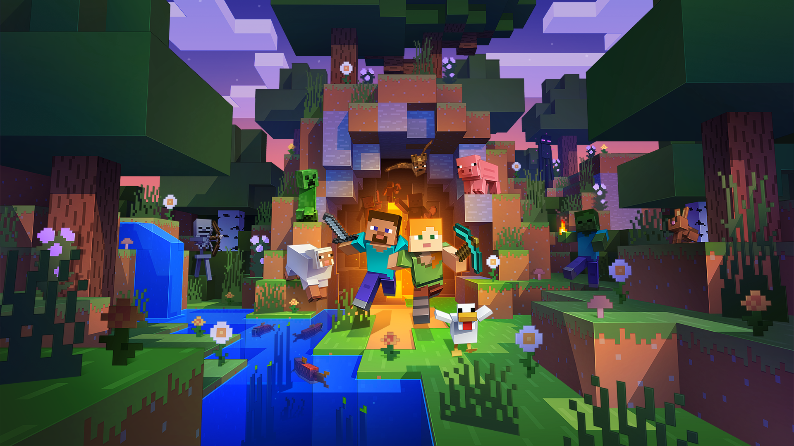
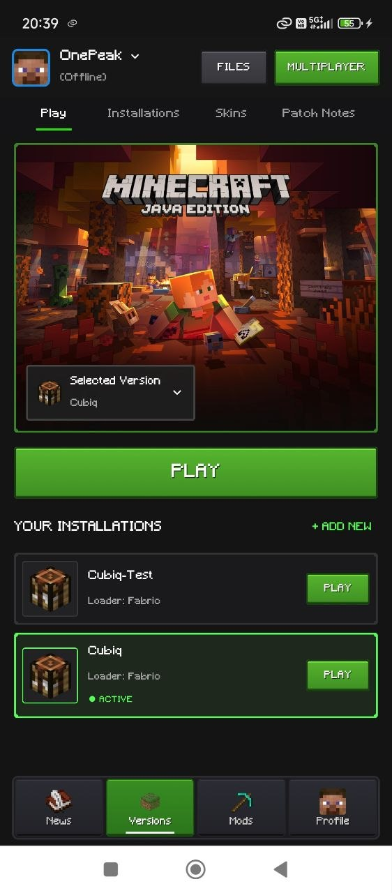
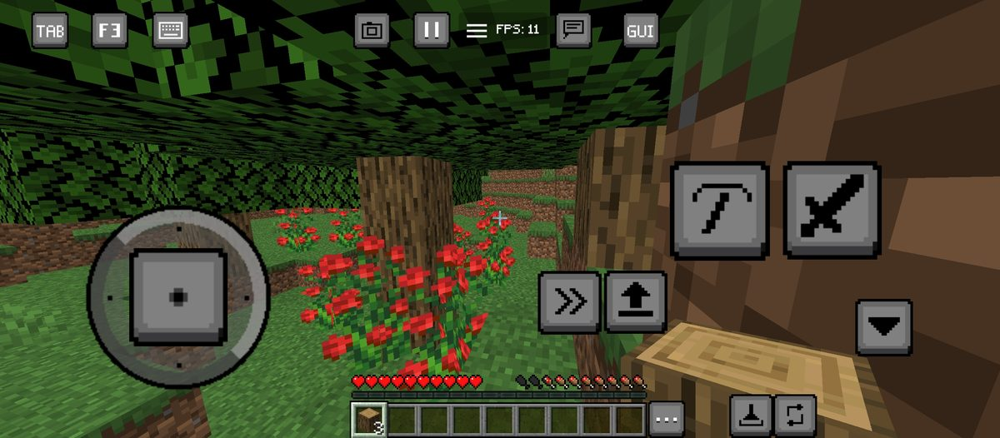
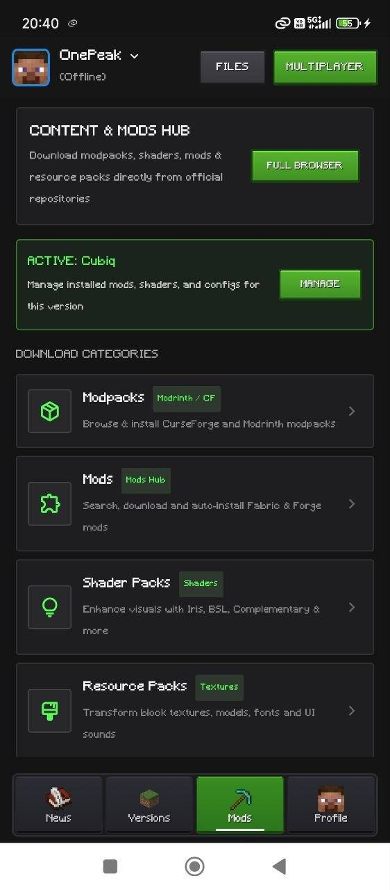
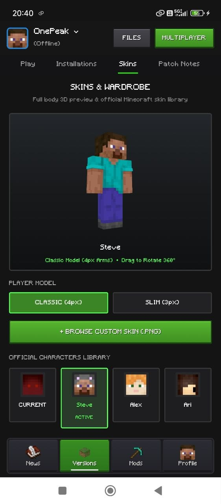

<p align="center">
  
</p>

<h1 align="center">Cubiq Launcher — Official Website</h1>

<p align="center">
  <b>The modern, lightning-fast landing page and download hub for Cubiq Launcher.</b><br>
  Experience Minecraft: Java Edition on Android with full Java 25 support, high-performance rendering layers, and customizable on-screen controls.
</p>

<p align="center">
  <a href="https://vivxkumar07.github.io/Cubiq-Website/"></a>
  <a href="https://github.com/VivxKumar07/Cubiq-Launcher/releases/tag/v1.1.0"></a>
  <a href="https://github.com/VivxKumar07/Cubiq-Launcher"></a>
</p>

---

## 🌐 Live Website

Access the official website anytime at:
👉 **[https://vivxkumar07.github.io/Cubiq-Website/](https://vivxkumar07.github.io/Cubiq-Website/)**

---

## 📱 About Cubiq Launcher

**Cubiq Launcher** is a next-generation Android client designed to run **Minecraft: Java Edition** on mobile devices and Chromebooks. Engineered for smooth frame rates, broad mod compatibility, and deep control customization, Cubiq bridges desktop Java gaming to Android with zero compromises.

### 🌟 Key Launcher Highlights
- ☕ **Java 25 & Modern Snapshot Ready**: Full out-of-the-box runtime provisioning for Java 21, Java 25, and Minecraft 26.x+ snapshots.
- 🚀 **Next-Gen Graphics Layers**: Built-in support for **LTW (Large Thin Wrapper)**, **MobileGlues**, **GL4ES**, and **Kopper (Vulkan/Zink)**.
- 🧩 **Mod Loader Ecosystem**: One-tap installation for **Fabric**, **Forge**, **NeoForge**, and **Quilt**.
- 🎮 **Customizable Controls**: Responsive on-screen touch controls, virtual mouse cursor, touchpad mode, and pre-built presets (*Pocket Edition*, *Mojo*, *Zalith*).
- 🎨 **Wardrobe & Customization**: Built-in Alex & Steve skin 3D previews, Ely.by and Microsoft account management, and anniversary capes.

---

## 📥 Direct APK Downloads (v1.1.0)

| Architecture | Device Type | Download Link |
| :--- | :--- | :--- |
| **ARM64 (arm64-v8a)** *(Recommended)* | Modern phones & tablets (Snapdragon, Dimensity, Tensor, Exynos 64-bit) | [⬇ Download APK](https://github.com/VivxKumar07/Cubiq-Launcher/releases/download/v1.1.0/Cubiq-1.1.0-arm64-v8a.apk) |
| **ARMv7 (armeabi-v7a)** | Older 32-bit Android devices | [⬇ Download APK](https://github.com/VivxKumar07/Cubiq-Launcher/releases/download/v1.1.0/Cubiq-1.1.0-armeabi-v7a.apk) |
| **x86_64** | 64-bit Android Emulators (BlueStacks, LDPlayer, WSA) & Chromebooks | [⬇ Download APK](https://github.com/VivxKumar07/Cubiq-Launcher/releases/download/v1.1.0/Cubiq-1.1.0-x86_64.apk) |
| **x86** | 32-bit x86 Android Emulators & Legacy Intel devices | [⬇ Download APK](https://github.com/VivxKumar07/Cubiq-Launcher/releases/download/v1.1.0/Cubiq-1.1.0-x86.apk) |

---

## 🖼️ Website Showcase

<p align="center">
  
</p>

<p align="center">
  
  
</p>

<p align="center">
  
  
</p>

---

## 💻 Website Tech Stack

- **Pure HTML5 & Modern CSS3**: Zero heavy external JavaScript frameworks for instant page load speeds.
- **Responsive Layout**: Designed mobile-first, adapting seamlessly across smartphones, tablets, foldables, and desktop displays.
- **Light & Dark Theme Engine**: System-aware with persistent theme toggling.
- **Search Engine Optimization (SEO)**:
  - Open Graph & Twitter Card preview integration.
  - JSON-LD Structured Data (`SoftwareApplication` schema) for Google Search rich snippets.
  - Canonical URL and targeted indexing keywords.
- **Dynamic Releases API Integration**: Automatically queries GitHub Releases to fetch the latest download URLs and version tags.

---

## 📁 Repository Structure

```text
Cubiq-Website/
├── assets/
│   ├── artwork/            # Banners, hero graphics, and promotional illustrations
│   ├── avatars/            # Alex, Steve, Creeper, and character icons
│   └── screenshots/        # High-resolution launcher screenshots
├── index.html              # Main single-page landing site
├── logo.png                # Official Cubiq Launcher brand icon
└── README.md               # Documentation and project overview
```

---

## 🛠️ Local Development

To run or preview the website locally:

1. **Clone the repository:**
   ```bash
   git clone https://github.com/VivxKumar07/Cubiq-Website.git
   cd Cubiq-Website
   ```

2. **Open with any local web server or browser:**
   - Double click `index.html` to open in any web browser.
   - Or start a quick Python server:
     ```bash
     python -m http.server 8000
     ```
   - Visit `http://localhost:8000` in your browser.

---

## 🤝 Community & Support

- **Main Repository**: [VivxKumar07/Cubiq-Launcher](https://github.com/VivxKumar07/Cubiq-Launcher)
- **Bug Reports & Feedback**: [GitHub Issues](https://github.com/VivxKumar07/Cubiq-Launcher/issues)
- **Author**: [Vivek Kumar](https://github.com/VivxKumar07)

---

<p align="center">
  Made with ❤️ for the Android Minecraft Community.
</p>
